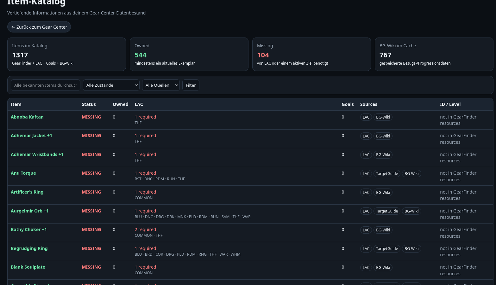
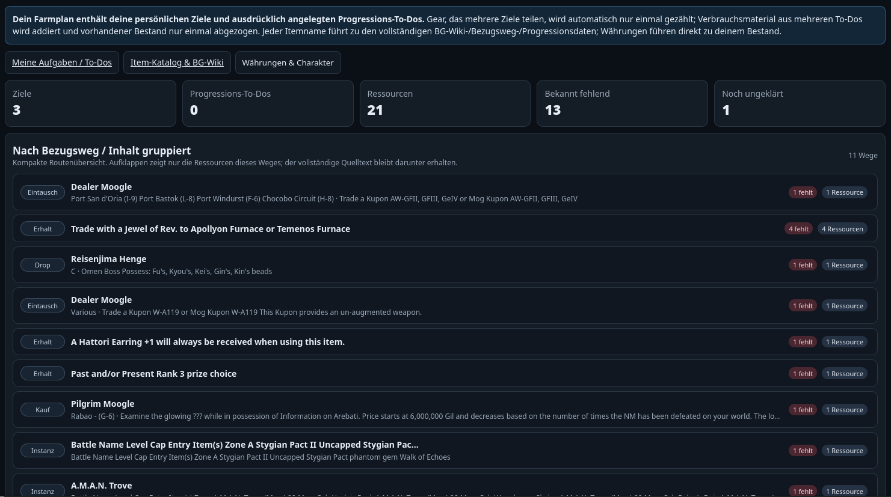

# FFXI Gear Center

Local-first gear, inventory, progression and farming center for **FINAL FANTASY XI**.

[](https://github.com/TGffxi/ffxi-gear-center-standalone/releases)
[](LICENSE)

This repository is the **public standalone distribution**. It does not require the separately developed FFXI Center application. FFXI Center is optional: if somebody already has it, the existing owner-token integration can share the same Gear Center services, but the normal public path is standalone.

The public package contains no player's character, inventory, goals, runtime snapshots or bundled third-party wiki/guide cache.

## Screenshots

### Item catalog



### Compact farming routes



## Highlights

- keeps physical copies of duplicate and augmented items separate by bag/slot/item identity;
- preserves LuAshitacast augments plus Path, Rank and Trial state;
- provides inventory, gear planning, personal goals, progression and farming views;
- keeps a last-known-good local inventory so FFXI does not need to be running just to browse and plan;
- resolves structured progression data without inventing stages from similar item names;
- supports explicit standalone start/stop/restart/open commands;
- binds normal API/Web services to `127.0.0.1`;
- can optionally share the same lifecycle with FFXI Center when that software is present.

## Requirements

The current installer targets the Linux/Ashita layout used by the project:

- FFXI base: `~/Games/FFXI`
- Ashita below that tree
- LuAshitacast configured below the Ashita tree
- Points addon
- PHP >= 8.2 with `pdo_sqlite`
- Python 3
- `curl`, `ss`, `flock`

**FFXI Center is not required.**

## Installation

Extract the release ZIP and run:

```bash
chmod +x install-1.0.sh rollback-1.0.sh
./install-1.0.sh
```

The installer creates a timestamped backup before mutation and automatically rolls back if installation fails after changes begin.

If FFXI Center is not installed, its integration step is simply skipped. No FFXI-Center file is required for a standalone installation.

## Standalone-Betrieb

After installation, start Gear Center independently:

```bash
~/Games/FFXI/scripts/gear-center-services.sh start
```

Open the local UI:

```bash
~/Games/FFXI/scripts/gear-center-services.sh open
```

Check status:

```bash
~/Games/FFXI/scripts/gear-center-services.sh status
```

Restart:

```bash
~/Games/FFXI/scripts/gear-center-services.sh restart
```

Stop the standalone owner and the services it owns:

```bash
~/Games/FFXI/scripts/gear-center-services.sh stop
```

The standalone lifecycle uses the same positive process identity, owner-token and crash-watchdog safeguards as the optional FFXI-Center integration. Foreign processes that merely occupy the configured ports are never killed.

**FFXI Center ist optional.** If it exists, the installer can integrate it as an additional lifecycle owner. This is compatibility only; it is not needed for normal standalone use.

## FFXI running vs. Gear Center running

FFXI itself does not need to be running in order to browse the last complete local state:

```text
Gear Center running + FFXI off
→ browse/plan using last-known-good local data

Gear Center running + FFXI on
→ live collectors can refresh local data
```

An empty, older or incomplete live frame does not replace a newer complete last-known-good inventory.

## Character selection

The public installer contains no hard-coded player name.

If exactly one LuAshitacast character directory exists, it is detected automatically. With multiple characters, choose one before installation:

```bash
export GEAR_CENTER_CHARACTER="PlayerName"
```

If the matching Ashita boot script cannot be detected, set it explicitly:

```bash
export GEAR_CENTER_BOOT="$HOME/Games/FFXI/ashita/scripts/playername.txt"
```

## First local data import

The public seed intentionally contains no private inventory and no bundled wiki/guide cache. Once your local FFXI/GearFinder/LuAshitacast data exists, import it with the shipped tools, for example:

```bash
cd "$HOME/Games/FFXI/tools/ffxi-gear-center"
php bin/import-gearfinder.php
php bin/import-lac.php
```

Selected/missing BG-Wiki data can then be fetched locally when desired:

```bash
php bin/import-bgwiki.php --missing --limit=20
```

Global guide/target synchronization performs network requests and should be run explicitly by the user.

## Kein-Sackgassen-Prinzip

Normal user views are designed to provide a useful next action: inventory items, goals, farm resources, currencies and known progression data lead back into details, planning or data-status views instead of ending in dead-end screens.

## Privacy

The public repository does **not** contain the original user's:

- character identity or server id;
- inventory or runtime snapshots;
- personal goals;
- LuAshitacast profiles/import state;
- augment/resource snapshots;
- bundled BG-Wiki/job-guide cache.

The bundled SQLite seed is schema-only. See [PUBLIC-DISTRIBUTION.md](PUBLIC-DISTRIBUTION.md), [PRIVACY.md](PRIVACY.md), [THIRD_PARTY-DATA.md](THIRD_PARTY-DATA.md) and [SECURITY.md](SECURITY.md).

## Rollback

```bash
./rollback-1.0.sh
```

A specific backup directory can also be supplied as the first argument.

## Tests

The repository includes regression coverage for historical feature behavior, duplicate/augment handling, API behavior, FFXI-Center compatibility and the standalone lifecycle. Standalone tests cover start/restart/stop idempotency, hard-crash cleanup and foreign-port safety without any FFXI Center installation.

## License

Released under the [MIT License](LICENSE).

## Disclaimer

FFXI Gear Center is an unofficial fan project and is not affiliated with or endorsed by Square Enix.
